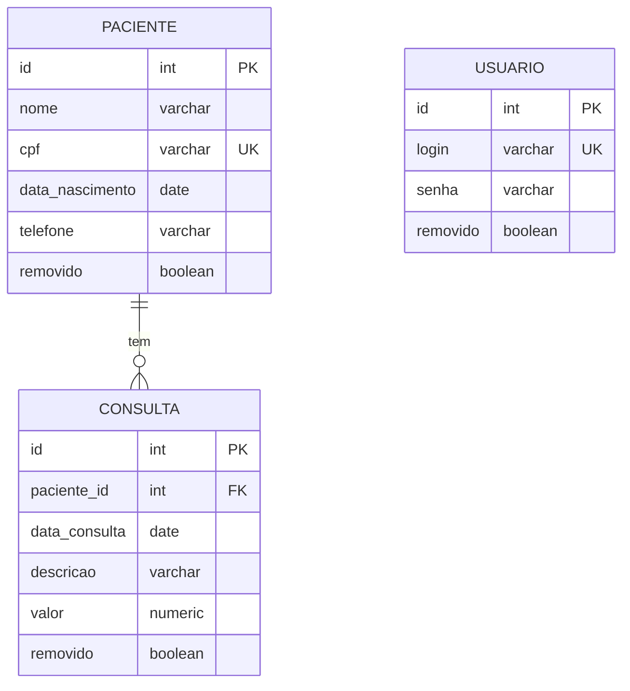

# Atendimento Saúde

Trabalho 02 de Desenvolvimento Web III: módulo de **saúde** de um ERP hospitalar, com CRUD de **Pacientes** e **Consultas** (relação 1:N), login com **JWT** e exclusão lógica (soft delete).

| Camada | Tecnologia | Porta |
|---|---|---|
| Front-end | Node.js + Express (HTML/CSS/JS puro) | 3000 |
| Back-end (API REST) | Python + Flask | 5000 |
| Banco de dados | PostgreSQL 16 | 5432 |

## Como executar

Pré-requisito: Docker com Docker Compose.

```bash
docker compose up --build -d
```

Depois acesse **http://localhost:3000** e entre com:

- **Login:** `saude`
- **Senha:** `saude`

**Para zerar o banco** (apaga os dados e recria as tabelas a partir do `init.sql`):

```bash
docker compose down -v
docker compose up --build -d
```

## Testando a API sem o front

> `tests/api.rest` no VS Code 

## Estrutura

```
atendimento-saude/
├── database/      init.sql (criação das tabelas)
├── backend/       API Flask  (app, auth, db, models/, controllers/)
├── frontend/      servidor Express + public/ (telas e chamadas à API)
├── tests/         api.rest
└── docker-compose.yml
```

# Mapeamento de Dados



**Cardinalidade 1:N:** um paciente tem **zero ou várias** consultas, e cada consulta pertence a **um único** paciente. A chave estrangeira fica no lado "N" (`consulta.paciente_id`).

`usuario` não se relaciona com as outras tabelas. Ela existe só para o login.

